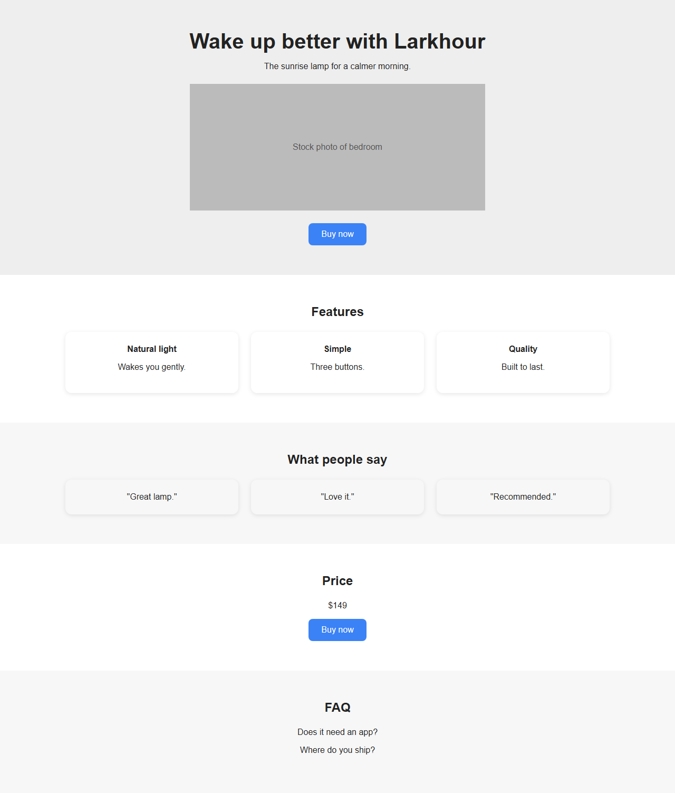
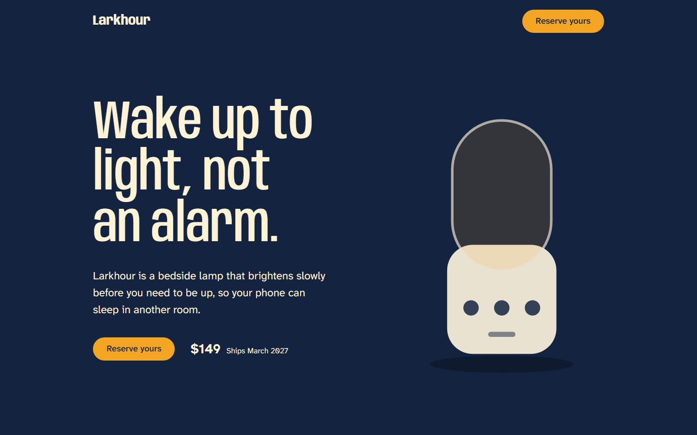
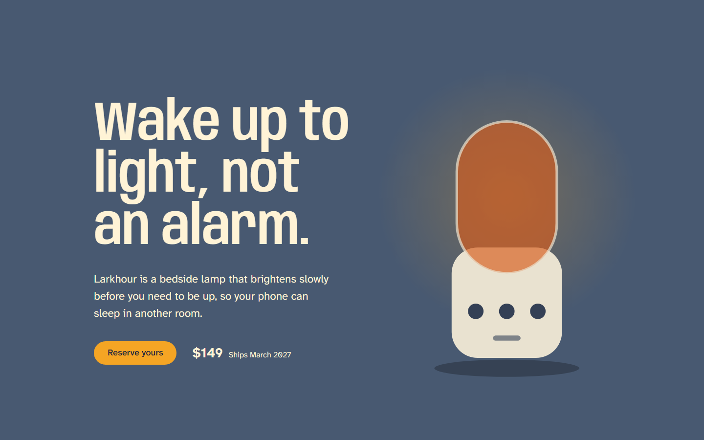
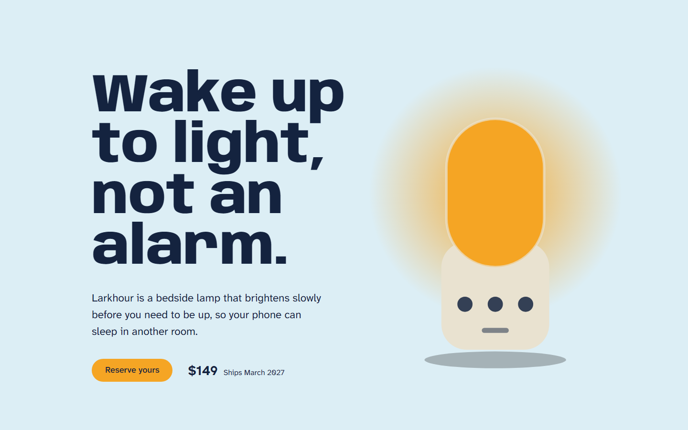
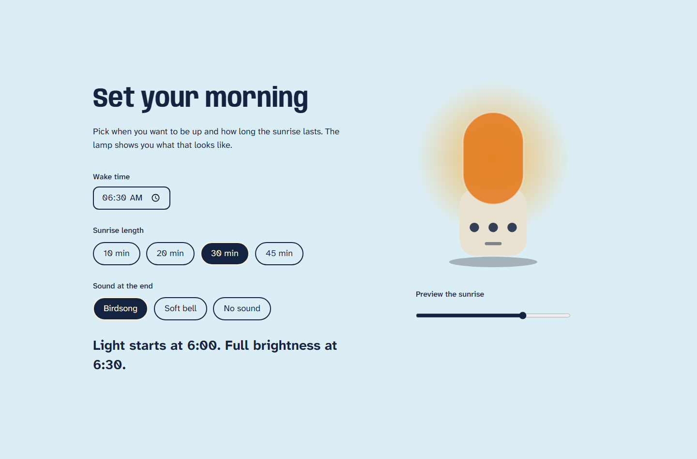

# Larkhour: a landing page that wakes up with you

Larkhour is a **fictional brand** I made for this portfolio demo. It is a bedside lamp that brightens slowly before you need to be up. The page does the same thing: it starts at night and brightens as you scroll.

I built it to show what a monthly landing page retainer looks like in practice: take a brand guide and a basic layout, make it responsive and editable by the client, add motion that means something, and suggest design improvements along the way.

| | |
|---|---|
| Live demo | https://larkhour-landing.vercel.app |
| CMS walkthrough | https://youtu.be/zJhk7mnq--8 (editing the headline in Sanity Studio and seeing it go live, 60 s) |
| Stack | Next.js 16 (App Router), TypeScript, Tailwind CSS 4, Sanity, GSAP + ScrollTrigger, Vercel |
| Content | The content of every section comes from Sanity and is editable without code |
| Quality | Lighthouse mobile on the live site: Performance 98 to 99, Accessibility 100, Best Practices 100, SEO 100 |
| Tests | 28 unit tests and 50 end-to-end tests (layout, motion, keyboard, accessibility, SEO) |

Lighthouse was run three times against the deployed site with simulated mobile throttling (`docs/lighthouse/mobile.json` holds one report). Scores move a point or two between runs.

## The brief

A client sends a brand guide (`docs/brand-guide.md`) and a basic layout (`docs/before-after/before-basic-mockup.png`). I turn them into a finished site:

- Fully responsive at 375, 768, 1024 and 1440 px.
- Content in a headless CMS, so the client edits without me.
- Motion, style and a polished finish.
- Interactions that help someone decide, not just decorate.
- Ideas that make the original concept better.

## The basic layout

This is the kind of layout I would normally receive: a stock photo hero, three identical feature cards, three testimonial cards, a price and an FAQ.



Nothing in it is wrong. But it describes the product instead of showing it, and every section looks the same.

## What I changed and why

| Basic layout | What I did | Why |
|---|---|---|
| A photo of a bedroom | The page itself wakes up. The lamp lights as you scroll, the background goes from night to a morning sky, and the headline stretches from narrow to wide | The one thing the lamp does is the thing the visitor feels in the first five seconds |
| Three cards of benefits | One comparison: a phone alarm against a 30 minute sunrise, drawn as a curve | One clear contrast is easier to remember than three claims |
| A list of features | A configurator: pick a wake time, a sunrise length and a sound, and see what the lamp will do | It makes the product personal, and it feeds the reservation |
| A form on its own | A reservation that carries the morning you just set up, the finish you chose and a live preview of the lamp | The visitor has already made decisions. The form should remember them |
| The same stacked layout on a phone | The anatomy section becomes a labelled list on a phone and a diagram with markers from 1024 px | A diagram with small markers is not usable at 375 px |
| Testimonials in cards | Two quotes set large, in different columns, marked as fictional | Quotes are voices, not boxes. Marking them avoids pretending they are real |







## Motion rules

I wrote these down before building and held myself to them (`docs/brand-guide.md`).

- Animate the light, responses to what the visitor does, and one load moment. Nothing else.
- No fade-up on each section. No parallax. Nothing that loops. Nothing that moves while someone is reading.
- 120 ms for responses, 240 ms for state changes, 900 ms for the one entrance.
- With `prefers-reduced-motion`, the hero is not pinned, there is no scrub, and the light jumps to its final state.
- The page is fully readable with JavaScript off.

## Things I tried and dropped

- **Hero headline at the full display size.** The type scale called for `14vw`. At 1440 px it pushed the price and the reserve button off the screen, so the hero uses `clamp(3.5rem, 8vw, 7rem)`. I only saw this by looking at a screenshot.
- **Fading the headline in on load.** It would have hidden the largest element from the browser until JavaScript ran. Only the lamp rises on load.
- **A faded colour for the inactive side of the switch.** The accessibility check flagged its contrast. It now uses weight and an underline.
- **An error message that pushed the submit button down.** On blur, a validation error appeared and moved the button, so the click missed. The space for the message is now always reserved. A test caught it.
- **A `/case-study` page.** This README is the case study. A second copy of it would only drift out of date.

## How it works

```text
app/(site)/            the landing page and any other page created in Sanity
app/studio/            Sanity Studio, served at /studio
app/api/revalidate/    webhook: Sanity publishes, the page updates
app/actions/reserve.ts server action for the reservation (validates, stores nothing)
components/sections/   one component per content section
components/lamp/       the lamp, drawn in SVG and lit by CSS variables
lib/motion/            motion tokens, GSAP loader, the scroll hook
lib/                   pure logic with unit tests (morning times, light curve, validation)
sanity/schemas/        content models
e2e/                   Playwright tests
```

- **One source of light.** The lamp and the page background read the same two CSS variables, `--light` and `--warmth`. The scroll hook writes them in the hero, and the sliders write them in the configurator. That is why the lamp and the room always agree.
- **Server first.** Pages are rendered on the server and cached with tags. Only the parts that need interaction run in the browser. GSAP loads after the first paint.
- **Content.** Pages are made of ordered sections in Sanity (`page.sections`). Colours, fonts, motion curves and durations are deliberately not editable. They belong to the brand and live in code.
- **Publishing.** A signed webhook calls `/api/revalidate`, which invalidates the cache tag for that content type. An edit appears on the live site without a redeploy.

### Adding another landing page

1. In Sanity Studio, create a **Landing page** and give it a slug, for example `spring-launch`.
2. Add sections from the list and fill in the fields.
3. Publish. The page is live at `/spring-launch` with no redeploy.

New section types are a schema in `sanity/schemas/sections`, a type in `lib/sanity/types.ts` and a component, registered in `components/SectionRenderer.tsx`.

### Setting up publishing

In the Sanity project, under API, Webhooks, create one webhook:

- **URL:** `https://<your-site>/api/revalidate`, method `POST`
- **Trigger on:** create, update and delete, on the `production` dataset
- **Filter:** `_type in ["page","product","siteSettings"]`
- **Projection:** `{_type}`
- **Secret:** the same value as `SANITY_REVALIDATE_SECRET`

Also add the site URL under API, CORS origins, with credentials allowed, so `/studio` can sign in. To check the whole chain, run `node --env-file=.env.local scripts/webhook-check.mjs https://<your-site>`. It changes the hero headline, waits for the site to show it, then restores it.

### Running it

```bash
npm install
cp .env.example .env.local   # add your Sanity project id and keys
npm run dev                  # http://localhost:3000
npm test                     # unit tests
npm run e2e                  # end-to-end tests, builds the app and uses local content
```

To seed an empty Sanity dataset with this content: `node --env-file=.env.local scripts/seed.ts`. It needs a token with Editor permission in `SANITY_API_WRITE_TOKEN`.

## What is not real

- Larkhour does not exist. The product, the quotes and the dates are made up.
- The reservation does nothing. It validates the form, stores nothing and takes no payment. The page says so wherever it asks for an email.
- I did not measure conversion. There is no traffic, so any number would be invented.
